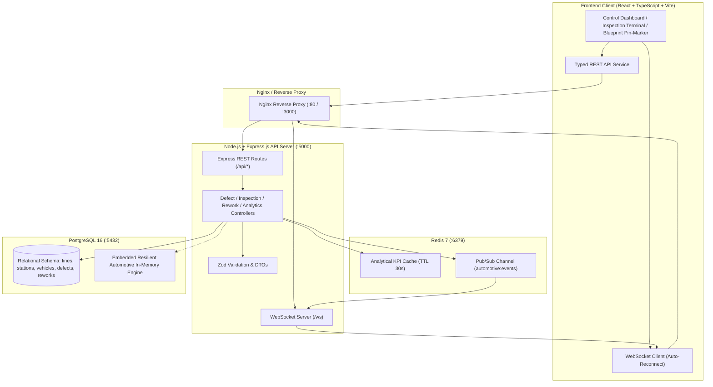

# 🚗 ApexQA - Automotive Assembly Quality Assurance & Real-Time Defect Telemetry Platform

[](https://github.com/dadithya68-cyber/AutoQC)
[](#tech-stack)
[](#architecture)
[](#docker-deployment)
[](#statistical-process-control--spc)

An enterprise-grade, real-time quality assurance and defect telemetry platform engineered for modern automotive gigafactories. The platform digitalizes assembly line inspection workflows, enables multi-angle 2D/3D spatial defect pinning on chassis blueprints, automates Ishikawa 6M root-cause rework dispatching, and computes live First Time Quality (FTQ) and Statistical Process Control (SPC) metrics.

### 🌐 Unified Single Localhost: `http://localhost:5000`
The frontend, backend REST API, and WebSocket stream are unified into a single localhost instance:
- **Web Application UI**: [http://localhost:5000](http://localhost:5000)
- **REST API Endpoints**: `http://localhost:5000/api/*`
- **Real-Time WebSocket**: `ws://localhost:5000/ws`

```bash
# Run everything unified on port 5000 with a single command:
npm start
# or double-click start-single-host.bat
```

---

## 📋 Table of Contents
- [Executive Overview](#executive-overview)
- [System Architecture](#system-architecture)
- [Key Features](#key-features)
- [Tech Stack](#tech-stack)
- [Database & Data Model](#database--data-model)
- [REST API Specifications](#rest-api-specifications)
- [Real-Time WebSocket & Redis Telemetry](#real-time-websocket--redis-telemetry)
- [Getting Started](#getting-started)
  - [Prerequisites](#prerequisites)
  - [Option A: Local Development](#option-a-local-development)
  - [Option B: Docker Compose](#option-b-docker-compose)
- [Git & GitHub CI/CD Workflow](#git--github-cicd-workflow)

---

## 🏭 Executive Overview

In automotive manufacturing, quality discrepancies (body weld spatter, clearcoat orange-peel, battery pack torque deviations, ADAS optical misalignments) must be caught at the workstation immediately before propagating downstream. 

**ApexQA** addresses this through:
1. **Zero-Paper Digital Inspection**: Tablets and touchscreen terminals replacing manual clipboards across Body, Paint, Powertrain, and Final Assembly.
2. **Interactive Spatial Defect Pinning**: Inspectors tap directly on multi-angle vehicle wireframes (Top, Side, Front, Rear) to log exact coordinates $(x, y)$, component tags, and severity levels.
3. **Ishikawa 6M Rework Tickets**: Closed-loop tracking classifying defects into Man, Machine, Method, Material, Measurement, or Environment, tracking Cost of Poor Quality (COPQ in USD).
4. **Plant Pacing & Line Control**: Real-time line state controls (Running, Slowed, Halted) synchronized with defect containment thresholds.

---

## 🏛 System Architecture



---

## ✨ Key Features

### 1. 🎯 Interactive 2D/3D Vehicle Inspection Blueprint & Pin-Marker
- Multi-angle visual schematics:
  - **Top View**: Hood, Panoramic Roof, High-Voltage Battery Subframe, Trunk Deck.
  - **Side Profile**: Front/Rear Doors, A/B/C Pillars, Rocker Panels, Wheel Arches.
  - **Front Fascia**: Bumper Lip, Grille, Windshield, Headlamps.
  - **Rear View**: Tailgate, LED Lightbar, Rear Diffuser.
- Interactive crosshairs: Clicking anywhere registers exact percentage coordinates $(x, y)$ and auto-detects the vehicle anatomical zone.
- Visual status pins: Red pulsing radar pins for Critical safety holds, Amber for Major functional items, Cyan for Minor cosmetic flaws.

### 2. 📋 Digital Workstation Inspection Workflow
- Pre-configured quality gate checklists for each workstation type:
  - **WS-101 (BIW)**: B-Pillar structural laser weld continuity, subframe shear resistance ($> 4.5\text{ kN}$).
  - **WS-102 (Gap/Flush)**: Fender-to-door gap nominal $3.5\text{ mm} \pm 0.5\text{ mm}$.
  - **WS-202 (Paint)**: Orange-peel Distinction of Image (DOI $\ge 92$), film thickness, dust inclusions.
  - **WS-301 (Powertrain)**: HV battery pack enclosure IP69K helium leak rate, chassis-to-pack M10 bolt torque ($65\text{ Nm} \pm 5\text{ Nm}$).
  - **WS-401 (ADAS)**: Forward camera pitch angle ($0.0^\circ \pm 0.15^\circ$), 77 GHz radar boresight calibration.
  - **WS-402 (Dyno)**: Four-wheel brake balance, 120 bar monsoonal water chamber test, NVH acoustic limits ($< 62\text{ dBA}$).
- Automatic dispositioning: `PASSED`, `CONDITIONAL_PASS`, or `FAILED`.

### 3. 🔧 Rework Bay & Ishikawa 6M Root Cause Analysis
- Digital Rework Orders linked directly to logged defects.
- Categorization across the 6 Ishikawa manufacturing causes:
  - **Man**: Operator ergonomics, fatigue, training.
  - **Machine**: Robotic nozzle wear, weld gun tip erosion, pneumatic drift.
  - **Method**: SOP torque sequence, adhesive curing cycle.
  - **Material**: Supplier batch porosity, primer viscosity.
  - **Measurement**: Optical camera glare, torque transducer calibration.
  - **Environment**: Paint booth humidity, ambient temperature.
- Cost of Poor Quality (COPQ) computation: labor minutes + replacement part cost.
- Quality Lead verification sign-off before vehicle release.

### 4. 📊 Statistical Process Control (SPC) & Quality Analytics
- **First Time Quality (FTQ %)**: Real-time percentage of units passing all stations without rework.
- **Defects Per Unit (DPU)** & **Defects Per Million Opportunities (DPMO)**.
- **Pareto 80/20 Analysis**: Dual-axis chart highlighting the vital 20% of defect causes driving 80% of plant losses.
- **Vehicle Anatomical Heatmap**: Defect density mapping identifying recurring failure locations.
- **Six Sigma Process Capability ($C_p, C_{pk}$)**: Continuous tolerance monitoring against upper/lower specification limits.

---

## 🛠 Tech Stack

| Domain | Technology | Description |
| :--- | :--- | :--- |
| **Frontend UI** | React 18 + TypeScript | Component-driven SPA with strict typing |
| **Styling** | Tailwind CSS + Lucide Icons | Dark industrial cockpit theme with custom pulse animations |
| **Charting** | Recharts | Composed Pareto charts, FTQ area trends, and gauges |
| **Build Tool** | Vite 5 | Instant HMR and optimized production bundling |
| **Backend API** | Node.js + Express.js | Layered MVC architecture (controllers, services, repositories) |
| **Type Validation** | Zod | Runtime schema validation for all API inputs |
| **Database** | PostgreSQL 16 | Relational persistence with foreign keys, constraints, and indexes |
| **Caching & PubSub** | Redis 7 (`ioredis`) | Fast sub-millisecond query cache & multi-instance telemetry sync |
| **Real-Time Stream** | WebSockets (`ws`) | Live push of defect markers and inspection events |
| **Containerization** | Docker & Docker Compose | Multi-stage production containers with healthcheck dependencies |
| **CI/CD** | GitHub Actions | Automated build, typecheck, lint, and docker compose validation |

---

## 🗄 Database & Data Model

The relational database is initialized with `backend/src/db/schema.sql`:

```sql
-- Core Tables
assembly_lines (id, name, code, target_hourly_rate, current_status)
workstations   (id, line_id, name, code, sequence_order, type, checklist_template)
vehicles       (id, vin, model, trim_level, color, current_line_id, status, defect_count)
inspections    (id, vehicle_id, vin, station_id, inspector_name, shift, status, checklist_results)
defects        (id, vin, vehicle_id, line_id, station_id, component, category, severity, coordinates, status)
rework_orders  (id, defect_id, vin, technician_name, root_cause_category, labor_minutes, cost_copq, verification_status)
```

> **Resilient Dual-Mode Engine**: If PostgreSQL or Redis are not reachable during local development, the backend automatically switches to its embedded, high-performance in-memory store with full seed telemetry data. It connects seamlessly to live PostgreSQL/Redis when available.

---

## 🔌 REST API Specifications

### Assembly Lines & Workstations
- `GET /api/lines` — List all assembly lines and current pacing status.
- `PATCH /api/lines/:id/status` — Update line state (`RUNNING`, `SLOWED`, `HALTED`).
- `GET /api/stations?lineId=...` — Workstations and checklist templates.

### Vehicles & Chassis
- `GET /api/vehicles` — Vehicle queue with status filter.
- `GET /api/vehicles/:vin` — Single vehicle specification and defect history.
- `POST /api/vehicles` — Launch a new chassis VIN into production.

### Defects & Telemetry
- `GET /api/defects` — Defect registry with multi-criteria filters (`lineId`, `severity`, `status`, `vin`).
- `GET /api/defects/:id` — Defect detail including exact chassis coordinates.
- `POST /api/defects` — Pin new defect on chassis blueprint and broadcast.
- `PATCH /api/defects/:id` — Update defect status or assign to rework.

### Digital Inspections
- `GET /api/inspections` — Historical station inspection audits.
- `POST /api/inspections` — Record completed workstation checklist.

### Rework Orders
- `GET /api/reworks` — List rework bay tickets.
- `POST /api/reworks` — Dispatch rework order with 5-Why root-cause analysis.
- `PATCH /api/reworks/:id` — Update rework status or sign-off quality certification.

### Quality Analytics & SPC
- `GET /api/analytics/kpis` — FTQ %, DPU, DPMO, Critical Holds, Active Reworks, COPQ.
- `GET /api/analytics/pareto` — Pareto 80/20 category distribution.
- `GET /api/analytics/trends` — Hourly FTQ run rate.
- `GET /api/analytics/heatmap` — Sub-assembly defect density heatmap.

---

## 🚀 Getting Started

### Prerequisites
- [Node.js](https://nodejs.org/) v18+ (tested on Node.js v24)
- [npm](https://www.npmjs.com/) v9+
- Optional: [Docker](https://www.docker.com/) & Docker Compose

---

### Option A: Local Development

#### 1. Clone & Setup
```bash
git clone https://github.com/dadithya68-cyber/AutoQC.git
cd AutoQC
```

#### 2. Install Dependencies
```bash
# Install backend
cd backend
npm install

# Install frontend
cd ../frontend
npm install
```

#### 3. Start Backend & Frontend
You can launch both services using the provided launcher:
```bash
# Windows double-click or run:
start-dev.bat
```

Or run them in separate terminals:
```bash
# Terminal 1: Backend API
cd backend
npm run dev
# Running on http://localhost:5000

# Terminal 2: Frontend Dashboard
cd frontend
npm run dev
# Running on http://localhost:5173
```

Open your browser to [http://localhost:5173](http://localhost:5173).

---

### Option B: Docker Compose

To start the complete multi-tier stack (PostgreSQL + Redis + Node.js API + Nginx Frontend):

```bash
docker compose up --build
```

- **Frontend Application**: [http://localhost:3000](http://localhost:3000)
- **Backend REST API**: [http://localhost:5000](http://localhost:5000)
- **PostgreSQL**: `localhost:5432` (`user: postgres`, `password: postgrespassword`, `db: automotive_qa`)
- **Redis**: `localhost:6379`

To stop the containers:
```bash
docker compose down
```

---

## 🌿 Git & GitHub CI/CD Workflow

The repository includes a ready-to-use GitHub Actions workflow configured in `.github/workflows/ci.yml`.

### Initialize Git Repository:
```bash
git init
git add .
git commit -m "feat: initial commit of automotive quality assurance & defect telemetry platform"
git branch -M main
git remote add origin https://github.com/dadithya68-cyber/AutoQC.git
git push -u origin main
```

### Automated CI Pipeline:
On every push and pull request, GitHub Actions automatically executes:
1. **Backend Matrix**: Installs dependencies and verifies TypeScript compilation.
2. **Frontend Matrix**: Runs Vite build and validates production assets.
3. **Docker Build Matrix**: Verifies all multi-stage Dockerfiles and container configurations.

---

## 📄 License
This project is open-sourced under the MIT License.
